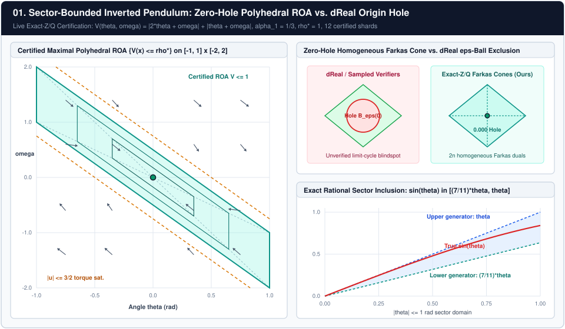
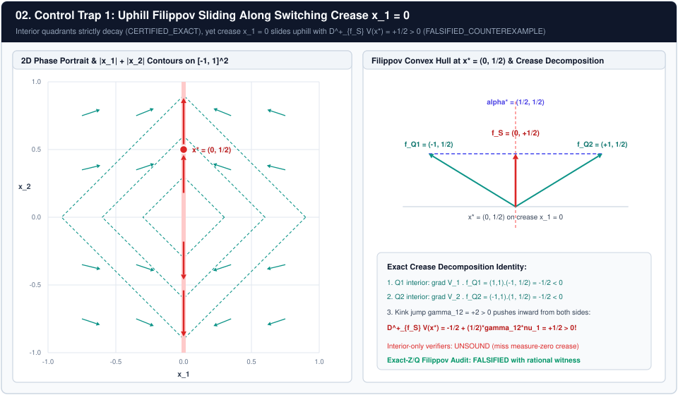
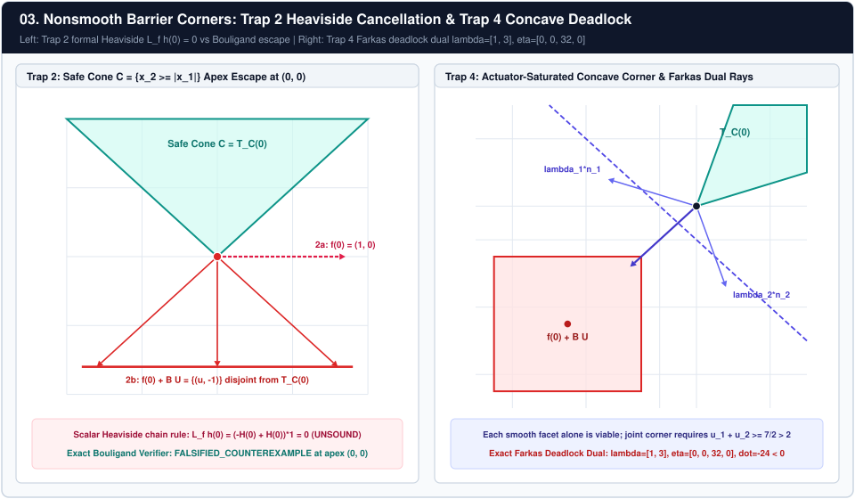
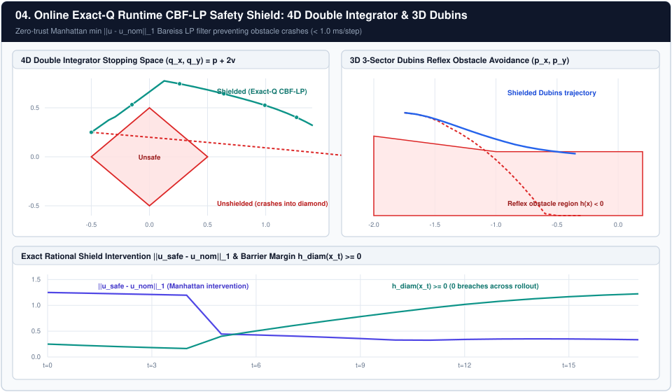
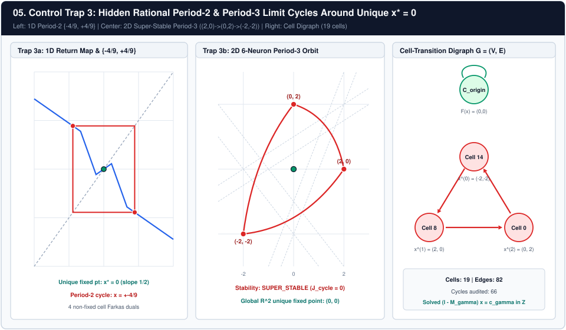
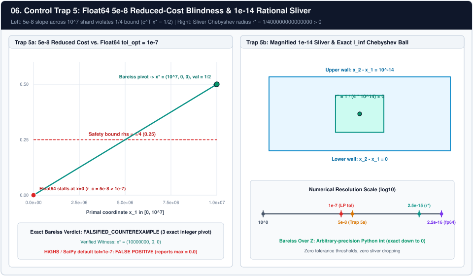
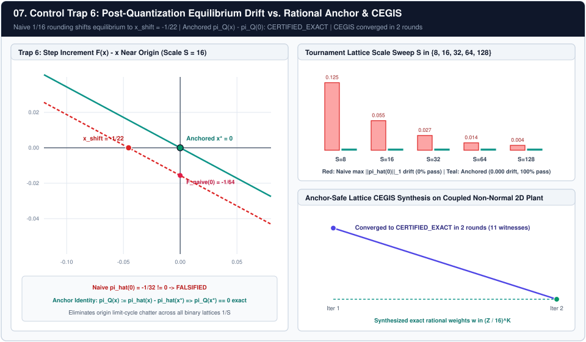
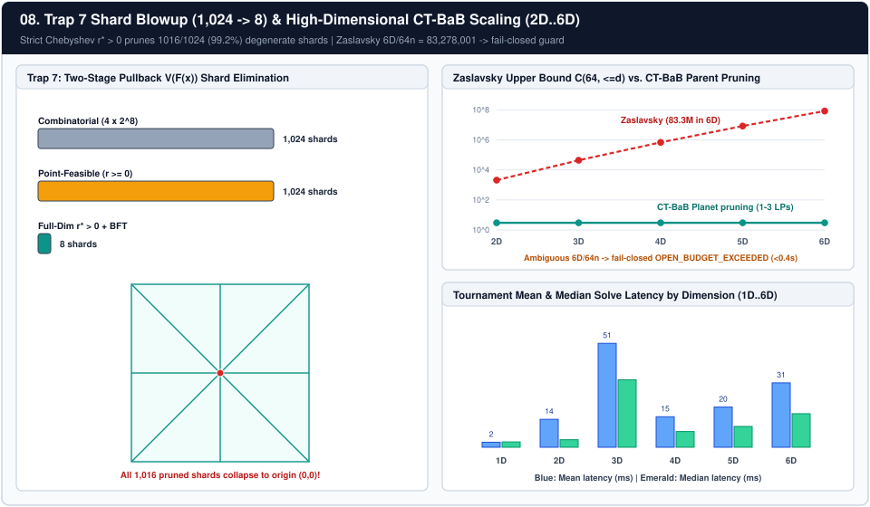
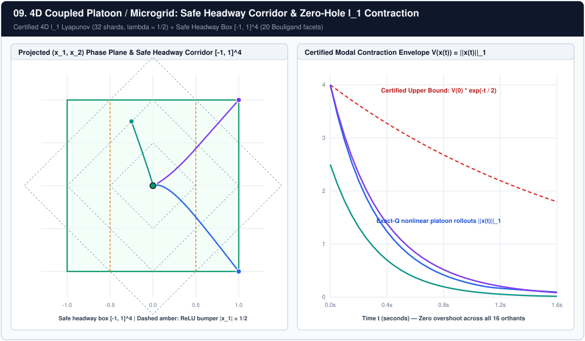
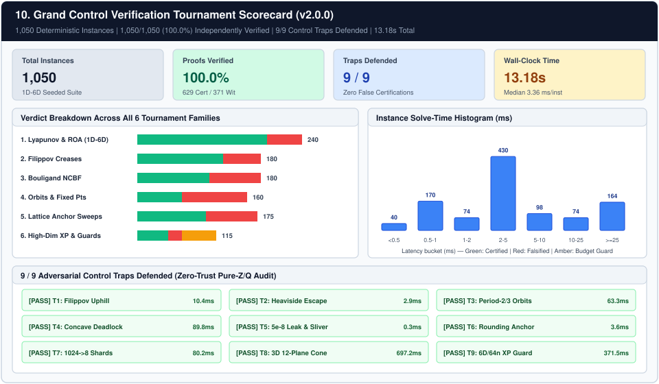

# `lyapunov_shield` (v2.0.0)

**Exact-$\mathbb{Z}/\mathbb{Q}$ Neural Lyapunov, Nagumo–Bouligand Barrier & Filippov Crease Verifier + Sub-Millisecond Online CBF-LP Safety Shield**

In safety-critical closed-loop control, floating-point feasibility tolerances (`1e-6`–`1e-7`), excised `1e-6` origin holes, interior-only derivative checks across discontinuous switching surfaces, and scalar Heaviside step-derivatives leave concrete soundness gaps on digital hardware; over $\mathbb{Z}$ and $\mathbb{Q}$, **Handelman degree-1 Farkas duality** closes all four with standalone $O(m \cdot n)$ integer proofs and exact rational counterexamples. `lyapunov_shield` implements this exact-arithmetic verification and runtime safety-filtering stack in zero-dependency pure Python ($\ge 3.9$) for low-to-moderate dimensional ($\le 6\text{D}$) piecewise-affine (PWA), sector-bounded, and ReLU neural control systems—compiling every stability, forward-invariance, Filippov sliding-mode, and rational Period-$k$ limit-cycle query into fraction-free Bareiss integer linear algebra over $\mathbb{Z}$.

---

## 5-Line Pure-Python Quickstart

```python
from lyapunov_shield import build_inverted_pendulum_sector_2d, verify_continuous_lyapunov, check_lyapunov_certificate_bundle

v_net, sector_plant, domain = build_inverted_pendulum_sector_2d(torque_limit=(3, 2))
result = verify_continuous_lyapunov(v_net, sector_plant, domain, decay_lambda=(1, 2), compute_maximal_roa=True)
assert check_lyapunov_certificate_bundle(result)
print(result.verdict.value, "alpha_1 =", result.alpha_1, "rho* =", result.rho_star)  # CERTIFIED_EXACT alpha_1 = (1, 1) rho* = (1, 1)
```

---

## Positioning in the 1992–2026 Neural Control Verification Literature

`lyapunov_shield` builds directly upon—and is designed as a complementary exact-arithmetic backend for—three decades of piecewise-affine and neural control verification research:

- **Polyhedral Lyapunov, Filippov & Nagumo Foundations**: Piecewise-quadratic and polyhedral Lyapunov theory (Johansson & Rantzer, *IEEE TAC* 1998), nonsmooth Filippov differential inclusions and Clarke/Dini generalized gradients (Shevitz & Paden, *IEEE TAC* 1994), symbolic lexicographic simplex pivoting (Avis & Fukuda, *Discrete Comput. Geom.* 1992), convex polyhedral union recognition (Bemporad, Fukuda & Torrisi, *IEEE TAC* 2001), and nonsmooth Nagumo–Bouligand barrier viability (Glotfelter, Cortés & Egerstedt, *IEEE L-CSS* 2017 / *IEEE TAC* 2019; Breeden & Panagou, *Automatica* 2023; Cohen, Lavretsky & Ames, 2025, arXiv:2509.04220).
- **Exact Rational LP & Certificate Checking**: Inspired by `VIPR` proof certificates for linear and mixed-integer programming (Cheung, Gleixner & Steffy, *IPCO* 2017 / extended tooling 2026) and exact rational neural network verification (Jia & Rinard, *SAS* 2021, arXiv:2003.03021), every `CERTIFIED_EXACT` verdict in `lyapunov_shield` carries pure-integer dual multipliers verified independently of the solver tableau.
- **Neural Lyapunov, Barrier & Limit-Cycle Verifiers (2021–2026)**:
  - *Discrete & Continuous Neural Lyapunov Synthesis*: Dai, Landry, Yang, Pavone & Tedrake (*RSS* 2021, arXiv:2109.14152) introduced $\ell_1$-regularized ReLU Lyapunov candidates $V(x) = \phi(x) - \phi(x^*) + \alpha \|R(x - x^*)\|_1$, supported directly via `build_dai_l1_lyapunov`. Counterexample-guided learners such as `FOSSIL 2.0` (Edwards, Peruffo & Abate, *HSCC* 2024) and Lyapunov-in-region-of-attraction verifiers (Yang, Dai, Shi, Hsieh, Tedrake & Zhang, *ICML* 2024, arXiv:2404.07956) accelerate candidate discovery, while `lyapunov_shield` closes floating-point solver tolerance gaps (`Trap 5`), origin-hole blindspots (`Fig. 01`), and post-quantization equilibrium shifts (`Trap 6`).
  - *ReLU Neural Control Barrier Functions*: Zhao, Chen, Zhao, Zhang, Tang & Li (*HSCC* 2022), Zhang, Wu, Vorobeychik & Clark (*NeurIPS* 2023; `SEEV`, *NeurIPS* 2024), and Ren, Xue, Wu & Xue (`evf-rnbc`, *AAAI* 2026, arXiv:2511.10015) advance ReLU NCBF synthesis and verification. `lyapunov_shield` enforces exact multi-facet Nagumo–Bouligand tangent-cone viability rather than scalar Heaviside step-derivative chain rules (which suffer `-H(0) + H(0) = 0` cancellation at cone apices, `Trap 2`), and emits Farkas deadlock duals $(\lambda, \eta) \ge 0$ at actuator-saturated concave corners (`Trap 4`).
  - *Periodic Orbits & Switching Creases*: Inspired by `SCYFI` heuristic cycle search in ReLU dynamical systems (Eisenmann, Monfared, Göring & Durstewitz, *NeurIPS* 2023 / 2026 extensions), `orbit_detector.py` builds the exact Bareiss Phase-I cell-transition digraph and solves unrolled rational linear systems $(I - M_\gamma) x^{(0)} = c_\gamma$ (`Trap 3`). For continuous-time switching surfaces, `filippov_crease.py` complements hyperplane-arrangement Lyapunov verifiers such as `Hyperlyve` (Yarbrough, Wayment, Wang, Paré & Sundaram, Nov 2026, arXiv:2611.21599) by auditing codimension-1 and codimension-$k$ discontinuous Filippov sliding creases via an exact joint tangent-multiplier LP (`Trap 1`).
  - *Scalable Bound Propagation*: Continuous-time branch-and-bound (`CT-BaB`, Shi et al., *L4DC* 2026) and GPU bound propagation (`alpha-beta-CROWN` for control, Li, Zhong, Cheng, Hu & Zhang, May 2026, arXiv:2605.26577) scale to wide networks via linear relaxations; `polyhedral_complex.py` implements an exact rational CROWN/Planet parent-box bound pruner (`certify_relu_upper_bound_ct_bab`) paired with deterministic fail-closed `OPEN_BUDGET_EXCEEDED` guards.

---

## Grand Control Verification Tournament Scorecard (`v2.0.0`)

The 1,050-instance tournament evaluates deterministic parametric sweeps across `1D–6D` canonical and synthetic control families—spanning discrete/continuous Lyapunov & exact-$\mathbb{Q}$ ROA certification, discontinuous Filippov creases, Nagumo–Bouligand NCBFs, exact rational Period-$2/3/4$ limit cycles, post-rounding lattice-snapping vs. anchor-subtraction sweeps, and `4D–6D` CT-BaB bound pruning—plus `50` deliberate cell-count and bit-length cap stress tests in Family 6B verifying clean fail-closed `OPEN_BUDGET_EXCEEDED` termination. Every emitted certificate and counterexample witness is independently checked during the run (`< 15s`), exporting SHA-256 signed telemetry to `results/grand_tournament_summary.json`:

```bash
python3 -m lyapunov_shield tournament
```

| Tournament Family | Instances | `CERTIFIED_EXACT` | `FALSIFIED_COUNTEREXAMPLE` | `OPEN_BUDGET_EXCEEDED` | Mean Solve (ms) | Independent Proof Check |
| :--- | :---: | :---: | :---: | :---: | :---: | :---: |
| **1. Lyapunov & Exact-Q ROA (`1D–6D`)** | 240 | 189 | 51 | 0 | 15.7 ms | `240 / 240` (`100%`) |
| **2. Discontinuous Filippov Creases (`2D–3D`)** | 180 | 125 | 55 | 0 | 6.7 ms | `180 / 180` (`100%`) |
| **3. Nagumo–Bouligand NCBF (`1D–3D`)** | 180 | 105 | 75 | 0 | 8.7 ms | `180 / 180` (`100%`) |
| **4. Rational Period-$2/3/4$ Orbits & Fixed Pts** | 160 | 65 | 95 | 0 | 13.4 ms | `160 / 160` (`100%`) |
| **5. Lattice Snapping vs. Anchor (`S=8..128`)** | 175 | 100 | 75 | 0 | 8.6 ms | `175 / 175` (`100%`) |
| **6. High-Dim XP (`4D–6D`, `16–64n`) & Guards** | 115 | 45 | 20 | 50 | 11.7 ms | `115 / 115` (`100%`) |
| **Total (+ `9 / 9` Control Traps Defended)** | **1,050** | **629** | **371** | **50** | **11.0 ms** | **`1,050 / 1,050` (`100%`)** |

---

## Visual Atlas of Exact-$\mathbb{Z}/\mathbb{Q}$ Control Verification (`figures/`)

Regenerate and geometry-audit (`OOB == 0`, `text_overlaps == 0`) all 10 pure-stdlib SVGs from live solver data:

```bash
python3 -m lyapunov_shield render-atlas
```

### 1. Zero-Hole Polyhedral ROA vs. `dReal` Origin Hole


### 2. Trap 1 — Filippov Uphill Sliding Along Switching Crease $x_1 = 0$


### 3. Trap 2 & Trap 4 — Heaviside Cancellation Escape & Concave Corner Deadlock


### 4. Sub-Millisecond Online Exact-$\mathbb{Q}$ CBF-LP Safety Shield (4D Integrator & 3D Dubins)


### 5. Trap 3 — Hidden Rational Period-2 & Period-3 Limit Cycles Around Unique Equilibrium


### 6. Trap 5 — Float64 `5e-8` Reduced-Cost Blindness & `1e-14` Rational Sliver


### 7. Trap 6 — Post-Quantization Equilibrium Drift vs. Rational Anchor Subtraction & CEGIS


### 8. Trap 7 — Pullback Shard Blowup (`1,024 -> 8`) & `2D..6D` CT-BaB Scaling


### 9. 4D Coupled Platoon / Microgrid Safe Headway Corridor & $\ell_1$ Contraction


### 10. Grand Control Verification Tournament Scorecard Dashboard


---

## PyTorch `state_dict` JSON Import & Anchor-Safe Quantization Guide

Export any trained `torch.nn.Sequential` ReLU Lyapunov candidate or controller to JSON (`{k: v.tolist() for k, v in model.state_dict().items()}`) and import it into `lyapunov_shield` (`lyapunov_shield/io_schema.py` is the sole boundary module permitted to use `fractions.Fraction`):

```python
import json
from lyapunov_shield import HPolytope, verify_discrete_lyapunov
from lyapunov_shield.io_schema import load_pytorch_state_dict_json

# Snap float weights onto binary lattice Z / 32 AND enforce exact equilibrium anchor V_Q(0) == 0:
state_dict = json.loads('{"0.weight": [[1.0, 0.0], [-1.0, 0.0], [0.0, 1.0], [0.0, -1.0]], '
                        '"0.bias": [0.1, 0.1, 0.0, 0.0], "2.weight": [[1.0, 1.0, 1.0, 1.0]], "2.bias": [-0.2]}')
v_anchored = load_pytorch_state_dict_json(state_dict, scale_denom=32, anchor_equilibrium=((0, 0), 1))
assert v_anchored.eval_scalar(((0, 0), 1)) == (0, 1)
```

> **Why `anchor_equilibrium` matters (`Trap 6`)**: Snapping floating-point ReLU controllers onto $\frac{1}{S}\mathbb{Z}$ without post-rounding subtraction $\pi_Q^{\mathrm{anc}}(x) := \hat{\pi}_Q(x) - \hat{\pi}_Q(x^*)$ leaves residual actuation $\hat{\pi}_Q(x^*) \neq 0$, shifting the closed-loop fixed point (e.g., $x_{\mathrm{shift}} = -\frac{1}{22}$ at $S = 16$) and inducing limit-cycle chatter.

---

## Complete CLI Reference

All CLI commands emit deterministic JSON summaries and optionally write SHA-256 signed proof bundles (`--output path.json`) verifiable via `lyapunov_shield.io_schema.verify_signed_certificate_bundle`:

```bash
# 1. Audit all 9 Adversarial Control Traps
python3 -m lyapunov_shield audit-traps --output results/traps_bundle.json

# 2. Certify discrete/continuous zero-hole Lyapunov stability & maximal exact-Q ROA
python3 -m lyapunov_shield verify-lyapunov --benchmark inverted_pendulum_roa --rate 1/2
python3 -m lyapunov_shield verify-lyapunov --input examples/inverted_pendulum_sector_model.json

# 3. Verify Nagumo-Bouligand NCBF & multi-facet corner viability under actuator saturation
python3 -m lyapunov_shield verify-barrier --benchmark dubins_3d
python3 -m lyapunov_shield verify-barrier --benchmark trap4

# 4. Audit codimension-1 & codimension-k Filippov sliding creases
python3 -m lyapunov_shield audit-filippov --benchmark trap1 --eps-slide 1/4

# 5. Extract fixed points, continuums, and exact rational Period-k limit cycles
python3 -m lyapunov_shield detect-orbits --benchmark trap3b --max-period 3

# 6. Execute a single sub-millisecond online exact-Q Runtime CBF-LP safety filter step
python3 -m lyapunov_shield shield-step --benchmark dubins_3d --state "[[0,-1,0],2]" --u-nominal "[[-3],1]"

# 7. Synthesize an anchor-safe rational ReLU Lyapunov function via bounded CEGIS
python3 -m lyapunov_shield synthesize-cegis --lattice-denom 16 --rate 1/10 --max-iters 15

# 8. Run the 1,050-instance Grand Control Verification Tournament (< 15s)
python3 -m lyapunov_shield tournament --seed 20261123 --output results/grand_tournament_summary.json

# 9. Regenerate all 10 publication SVGs and run the zero-defect geometry audit
python3 -m lyapunov_shield render-atlas
```

---

## Honest Scope & Conservatism Boundaries

`lyapunov_shield` makes deliberate engineering trade-offs to achieve **zero-float, zero-hole, proof-producing exactness** in pure Python:

1. **Co-NP-Completeness & XP Arrangement Scaling Above $6\text{D}$**: Exact ReLU/PWA Lyapunov and barrier verification is co-NP-complete in network width, and hyperplane arrangements in $\mathbb{R}^n$ have worst-case Zaslavsky complexity $\sum_{k=0}^n \binom{H}{k} = O(H^n)$ (e.g., $83{,}278{,}001$ cells for $H = 64$ general-position hyperplanes in $6\text{D}$, `Trap 9`). While `bft_merge_cells` and `certify_relu_upper_bound_ct_bab` prune redundant splits and unsplit parent boxes when CROWN/Planet envelopes suffice, ambiguous high-dimensional arrangements above $6\text{D}$ or wide multi-layer MLPs exceed pure-Python CPU budgets and deterministically return `OPEN_BUDGET_EXCEEDED` (fail-closed, never guessing).
2. **Rational Sector-Wedge Conservatism on Smooth Nonlinearities**: Because transcendental plants ($\sin\theta$, $\cos\theta$, aerodynamic drag) are not natively rational PWA maps, `lyapunov_shield` verifies them via conservative rational differential/difference inclusions (`SectorPWAPlant`, e.g., $\sin\theta \in [\frac{7}{11}\theta, \theta]$ on $|\theta| \le 1$). A `CERTIFIED_EXACT` verdict rigorously holds for *every* smooth plant trajectory inside the sector wedge, whereas a `FALSIFIED_COUNTEREXAMPLE` on a coarse sector envelope may reflect sector over-approximation until the domain is partitioned into finer angular sectors (as in the 3-sector Dubins benchmark).
3. **When to Use GPU Bound Propagators vs. Exact-$\mathbb{Z}/\mathbb{Q}$ Farkas Certification**:
   - **Use GPU bound propagation (`alpha-beta-CROWN`, `CT-BaB`) or `FOSSIL 2.0` / `LyZNet`** during training and candidate screening on high-dimensional ($n > 6$) or wide ($H > 100$) neural controllers where throughput and branch-and-bound parallelism dominate.
   - **Use `lyapunov_shield`** for safety-critical low-dimensional embedded loops ($n \le 6$: attitude, pendulum/cart-pole, Dubins/lane keeping, double-integrator corridors, coupled oscillator/platoon modes, quantized $\frac{1}{S}\mathbb{Z}$ controllers, and online `< 1 ms` runtime CBF-LP shielding) where eliminating origin holes, `1e-7` tolerance leaks, Filippov crease traps, Bouligand corner deadlocks, and post-rounding equilibrium drift with machine-checkable integer Farkas proofs is paramount.
4. **Mathematical Model vs. Physical Plant Gap**: Exact $\mathbb{Z}/\mathbb{Q}$ certificates guarantee stability and forward invariance of the formalized discrete-time PWA map or continuous-time sector differential inclusion. Physical hardware deployment still requires accounting for ADC/sensor noise and quantization, zero-order-hold (ZOH) inter-sample ripple between discrete ticks, unmodeled high-frequency parasitics, and actuator transport delay (e.g., by inflating disturbance/sector tubes prior to certification).

See [MATHEMATICAL_SPEC.md](MATHEMATICAL_SPEC.md) for complete mathematical derivations and run `python3 verify_all.py` to execute the 5-stage clean-room verification suite in `< 45s`.

---

## Author, License & Related Exact-Z/Q Repositories

- **Author & License**: Bob Preece — released under the [MIT License](LICENSE) (Copyright (c) 2026 Bob Preece).
- **Sibling Pure-Python Exact-$\mathbb{Z}/\mathbb{Q}$ Packages**:
  - `ultrafinitist-physics-over-Q` — exact rational discrete variational & conservative mechanics without floating-point drift.
  - `sheaf-radar-over-Z-and-Q` — exact integer/rational cellular sheaf cohomology and multi-sensor consistency auditing.
  - `tropical-grokking-decompiler` — exact rational tropical / piecewise-linear decompilation of trained ReLU networks.
